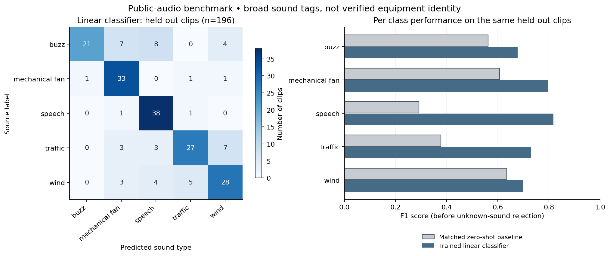

# AI sound-hint experiment — October 18, 2026

**Status: completed Colab experiment; `promotionAllowed: false`.** A small classifier improved broad sound-tag performance on this selected public-audio benchmark. Browser parity and independent field validation remain outstanding. This experiment does not replace the app's current eight-description sound hints.

The notebook recorded source commit [`d3ae48cd0fbf9f743cc442cbfd08d178a3e48bda`](https://github.com/Antigro09/Hackathon/commit/d3ae48cd0fbf9f743cc442cbfd08d178a3e48bda), seed **804**, Python **3.13.16**, and a **725 × 512** embedding matrix. The CLAP encoder stayed frozen. Only a regularized logistic-regression head was trained; this was not full-model fine-tuning.

## Data and comparison

Sources: [FSD50K mirror on Hugging Face](https://huggingface.co/datasets/Fhrozen/FSD50k) and [original FSD50K release](https://zenodo.org/records/4060432).

The run selected **725 FSD50K clips from 581 uploaders**: 399 CC0 and 326 CC BY 3.0 clips with per-clip attribution. Each input used its first five seconds, first channel, resampled to 48 kHz, followed by the browser-compatible five seconds of zero-padding for CLAP. Encoder artifacts and preprocessing metadata were pinned to `Xenova/clap-htsat-unfused` revision `c28f2883575e590e04d3146ff0713c2448d691ba` and checked by SHA-256.

| Split | Clips | Distinct uploaders |
|---|---:|---:|
| Known training | 291 | 198 |
| Known validation | 78 | 61 |
| Known test | 196 | 162 |
| Unknown validation | 80 | 80 |
| Unknown test | 80 | 80 |

An independent manifest check found no cross-split overlap in uploaders, clip IDs, original/prepared audio hashes, or PCM hashes. Five-fold uploader-group cross-validation within training selected **C = 1.0** from 0.01, 0.1, 1, and 10. Rejection thresholds were chosen using known/unknown validation only, then frozen before test evaluation. Reviewing the implementation found no test-set use in those selection steps.

The comparison used **five matched labels**: buzz, mechanical fan, speech, traffic, and wind. Its baseline ranks cosine similarity between the same frozen audio embeddings and separate quantized CLAP text-branch embeddings of fixed broad-label prompts. It does **not** reproduce the live app's eight equipment-oriented descriptions, combined graph, or relative scores. Both systems' rejection gates also use class centroids derived from labeled training audio; the gated baseline is therefore not entirely zero-shot.

## Held-out results

| Metric | Frozen-encoder linear head | Matched five-label cosine baseline |
|---|---:|---:|
| Known test clips | 196 | 196 |
| Macro F1 before rejection | **0.7439** | 0.4948 |
| Balanced accuracy before rejection | **75.33%** | 52.94% |
| Known coverage after rejection | **41.84% (82/196)** | 34.18% (67/196) |
| Accuracy among accepted known clips | **87.80% (72/82)** | 86.57% (58/67) |
| Unknown test false accepts | **0/80** | 0/80 |
| Unknown false-accept Wilson 95% interval | **0–4.58%** | 0–4.58% |
| Unknown validation false accepts, used to select the rule | 8/80 (10%) | 8/80 (10%) |

The head abstained on **114 of 196 known clips** and still made **10 errors among its 82 accepted clips**. The accepted-accuracy comparison uses different accepted subsets; it does not establish a statistically significant improvement. Scores and centroid similarities are decision quantities, not calibrated confidence or equipment-identity probabilities.

The figure was rerendered locally from the saved evaluation to keep its legend clear of the data; no metrics, predictions, or thresholds were changed. It shows performance before rejection, so it does not display the speech-coverage failure below.

The selected head rule was predicted-class centroid cosine **≥ 0.609697327931026**, with no decision-margin threshold. This is an empirical validation-set rule, not a guaranteed boundary for unfamiliar recordings.

## Per-class weaknesses

Recall and F1 describe all known test clips before rejection; the final two columns describe the frozen rejection rule.

| Sound tag | Test clips | Ungated recall | Ungated F1 | Accepted clips | Correct among accepted |
|---|---:|---:|---:|---:|---:|
| Buzz | 40 | **52.50%** | 0.6774 | 21/40 | 17/21 |
| Mechanical fan | 36 | 91.67% | 0.7952 | 24/36 | 24/24 |
| Speech | 40 | 95.00% | 0.8172 | **1/40** | **0/1** |
| Traffic | 40 | 67.50% | 0.7297 | 19/40 | 17/19 |
| Wind | 40 | 70.00% | 0.7000 | 17/40 | 14/17 |

Buzz remained the weakest ungated tag: **19/40 were missed**, including eight labeled speech and seven labeled mechanical fan. Training was particularly small for buzz (**35 clips from 14 uploaders**) and mechanical fan (**38 clips from 23 uploaders**).

The rejection gate almost eliminated speech availability: **39/40 speech clips were rejected, and the single accepted clip was wrong**. The gate maximizes useful accepted validation answers overall and imposes no minimum coverage per class. This is a material promotion blocker despite the strong ungated speech recall.

## Limits and promotion gates

- Unknown validation used rain, water, footsteps, and dog clips; unknown test used music, bird, bell, and door clips. **0/80 is not a guarantee** for other sounds, mixtures, or microphone conditions. Wilson intervals quantify clip-level binomial sampling uncertainty; they do not correct selection bias or uploader dependence.
- FSD50K labels describe complete source clips. A five-second crop can contain mixed sounds or omit the labeled event; the run did not establish human-verified labels for every crop. Short, quiet, clipped, and disallowed-license material was excluded, narrowing the population represented.
- Uploader separation and exact hash checks do not exclude near-duplicates or audio encountered during CLAP pretraining. Independent pretraining overlap remains unresolved.
- These broad tags cannot identify a transformer, light fixture, particular cooling system, facility, or transmission path. Device, room, distance, and real microphone-domain performance remain unvalidated.
- Promotion requires the exact candidate audio encoder, preprocessing/resampling, normalized embeddings, linear scores, and rejection decisions to pass shared Python/browser WASM checks. It also requires independent recordings across devices and environments, crop-level label review, and acceptable per-class coverage and errors with abstention retained. Model or threshold changes motivated by these test results need fresh validation and a new untouched final test set.

Evidence: [notebook source](../notebooks/TonalWatch_Audio_Training.ipynb), [complete evaluation](../ml/runs/2026-10-18/evaluation.json), [portable head](../ml/runs/2026-10-18/linear_probe.json), [attribution manifest](../ml/runs/2026-10-18/manifest.json), [run environment](../ml/runs/2026-10-18/run_environment.json), and [package inventory](../ml/runs/2026-10-18/pip-freeze.txt). Reproduce with the notebook's `SOURCE_REF` set to the recorded immutable commit above.

The downloaded manifest's SHA-256 is `1c5f7a8ba2f5d38c661073deeadc5253a5e4c70ce8d2143a975a69a392731549`; independent recomputation matched the saved environment. NumPy 2.2.6, scikit-learn 1.7.2, and ONNX Runtime 1.23.2 were recorded. The portable head deliberately retains `promotionAllowed: false`.

## Browser resampling correction

A later synthetic diagnostic identified different 44.1→48 kHz conversion in the browser's Web Audio renderer and training's SciPy pipeline. The app now uses a deterministic Float32 polyphase FIR matching the default Kaiser(beta=5), zero extension and alignment of [SciPy 1.15.3 `resample_poly`](https://docs.scipy.org/doc/scipy-1.15.3/reference/generated/scipy.signal.resample_poly.html). This affects only the separate five-second AI copy; full-duration DSP/report PCM is preserved.

Independent checked-in SciPy references cover 20 tone, noise and boundary impulse cases at 16, 32, 44.1, 48 and 96 kHz, checking 448 positions per case. A one-off Chrome 155/WASM run using the actual compiled app resampler matched SciPy **bit-exactly on every sample** of six complete five-second signals (63 Hz, 1 kHz and seeded noise, each at 44.1/48 kHz). Log-mel maximum absolute difference was 7.63e-6.

For the three 44.1 kHz cases, browser/native embedding cosine changed from 0.98885/0.98726/0.99649 to 0.999778/0.999739/0.999671. The remaining backend difference also occurred with identical feature inputs: cosine 0.999671–0.999832 and maximum coordinate error 0.003481. The native runtime was ONNX Runtime CPU 1.23.2; browser inference used Transformers.js 4.3.1 and the pinned ONNX Runtime Web build, one WASM thread. Both loaded the same verified audio-only q8 graph.

This verifies a resampling correction on generated inputs, **not classifier decisions, rejection thresholds, field accuracy, other browsers or the deployed combined graph's equivalence to the experimental audio-only branch**. The trained classifier remains unpromoted. Evidence: [before](../ml/runs/2026-10-18-browser-parity/before.json), [after](../ml/runs/2026-10-18-browser-parity/after.json), [loopback-only network check](../ml/runs/2026-10-18-browser-parity/browser-check.json), and [independent reference generator](../tests/fixtures/resample-poly/generate.py).
