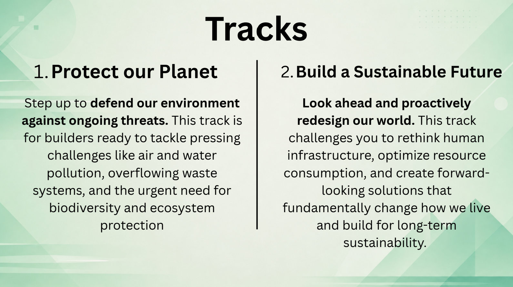

# TonalWatch — Resources Index

## Official 804 Hacks (read these first)
- **Judging rubric (100 pts)**: https://docs.google.com/document/d/18qsN9ITcCPEGY4uMNW0Q54AK5lkNU78DbPR7Gfs0-SE — Functionality 35 / Team Chem 20 / Problem-Solution 20 / Q&A 10 / UVP 10 / Marketing 5. Pitch max 5 MIN, ALL members speak, 2-min Q&A.
- **Devpost resources**: https://804hacks.devpost.com/resources
- **Tracks**: 1) Protect our Planet (OURS — defend against ongoing threats, air/water pollution) 2) Build a Sustainable Future.
- **Tracks screenshot**:  — verbatim: Track 1 "Protect our Planet — Step up to defend our environment against ongoing threats... air and water pollution, overflowing waste systems, and the urgent need for biodiversity and ecosystem protection." Track 2 "Build a Sustainable Future — Look ahead and proactively redesign our world... rethink human infrastructure, optimize resource consumption... build for long-term sustainability."

## The legal seam (our citations)
- Loudoun County noise page (the admission in their own words): https://www.loudoun.gov/6405/Noise-Air-Quality-Concerns — dBA standards "do not capture low frequency noise or the discomfort caused by steady tonal sounds"; no tonal/low-frequency regulatory language; amendments anticipated 2027.
- Loudoun limit: 55 dBA residential lot line (Z.O. §7.05.03).
- **Prince William County Ordinance 25-62** (eff. May 1, 2026): first regional C-weighted tonal standard — 73 dBC day / 68 dBC night. THE precedent.

## The human cost (quotes for the pitch)
- WUSA9 (Apr 2026): HOA president: "It's like having tinnitus without having tinnitus."
- NBC4 (Mar 2026): hum audible >1 mile away; News4 measured 90 dB near an Ashburn facility; zoning enforcement opened an investigation.

## Project facts
- Diagnostic: A-vs-C gap > ~15 dB = low-frequency tonal signature (offset cancels — no calibration needed for the gap).
- Validated range-finder data (10/17): HF chain solid 16k+; LF workable 5-45 Hz (mains+chiller band), fluctuates = physics (speaker roll-off, standing waves), not defect.
- Honest-claims law: consumer mics are indicators, not certified instruments → output requests county engineer measurement.